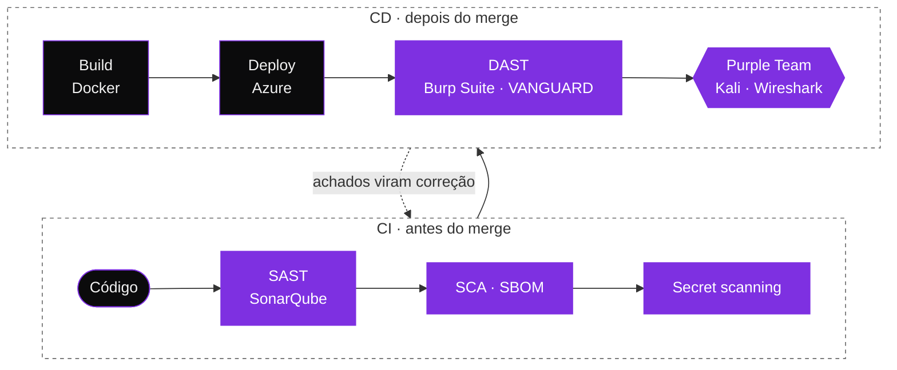

<p align="center">
  
</p>

<div align="center">

# Opa, belezinha? 👋

Bem-vindo ao meu GitHub! Sou o **Rafa**, aprendiz de tecnologia atuando em **DevSecOps** e **Purple Team**, apaixonado por desenvolvimento de software, segurança de aplicações e engenharia de dados.


</div>

<p align="center"></p>

## 01 · Sobre mim

```javascript
const rafa = {
  localização:      "Campinas, São Paulo — Brasil",
  emprego:          "DevSecOps & Purple Team",
  formação:         [
                      "Técnico em MSI — IFSP (concluído)",
                      "Técnico em Desenvolvimento de Sistemas — SENAI (em andamento)"
                    ],
  interesses:       ["DevSecOps & Cybersecurity", "Full Stack Development", "Data Engineering & AI", "Cloud"],
  construindoAgora: ["VANGUARD — DAST Platform", "PanGuard — CVE Tracker"],
  hobbies:          ["Codar", "Jogar", "Tocar Guitarra", "Aprendizado contínuo"],
  objetivo:         "Construir soluções que resolvem problemas reais — com segurança desde a fundação"
};
```

## 02 · Na esteira

Segurança em cada etapa, do commit à produção, e de volta para o código quando o Purple Team encontra algo.



<sub>Em roxo, as etapas em que a segurança entra.</sub>

## 03 · Arsenal

O que uso no dia a dia. O resto fica recolhido logo abaixo.

<table>
  <tr>
    <td width="170"><b>🔐 Segurança</b></td>
    <td>
      
      
      
      
      
    </td>
  </tr>
  <tr>
    <td width="170"><b>⌨️ Linguagens</b></td>
    <td>
      
      
      
      
    </td>
  </tr>
  <tr>
    <td width="170"><b>☁️ Cloud & infra</b></td>
    <td>
      
      
      
      
      
    </td>
  </tr>
  <tr>
    <td width="170"><b>⚡ Back-end</b></td>
    <td>
      
      
      
      
    </td>
  </tr>
  <tr>
    <td width="170"><b>🎨 Front-end</b></td>
    <td>
      
      
      
      
    </td>
  </tr>
  <tr>
    <td width="170"><b>🎲 Dados & IA</b></td>
    <td>
      
      
      
      
      
      
    </td>
  </tr>
</table>

<details>
<summary><b>Também já usei</b></summary>
<br />
<p>
  
  
  
  
  
  
  
  
  
  
  
  
  
  
  
  
  
  
  
</p>
</details>

## 04 · Projetos

<table>
  <tr>
    <td width="50%" valign="top">
      <h3>VANGUARD</h3>
      <p>Plataforma de DAST.</p>
      
      <!-- TODO: 1 ou 2 linhas sobre o problema que resolve, a stack e o link do repositório -->
    </td>
    <td width="50%" valign="top">
      <h3>PanGuard</h3>
      <p>Tracker de CVEs.</p>
      
      <!-- TODO: 1 ou 2 linhas sobre o problema que resolve, a stack e o link do repositório -->
    </td>
  </tr>
</table>

## 05 · Atividade

<p align="center">
  <picture>
    <source media="(prefers-color-scheme: dark)" srcset="https://raw.githubusercontent.com/rafafrd/rafafrd/output/github-snake-dark.svg" />
    <source media="(prefers-color-scheme: light)" srcset="https://raw.githubusercontent.com/rafafrd/rafafrd/output/github-snake.svg" />
    
  </picture>
</p>

<p align="center"></p>

<p align="center"><sub>BUILD › BREAK › FIX · valeu pela visita! 👾</sub></p>
